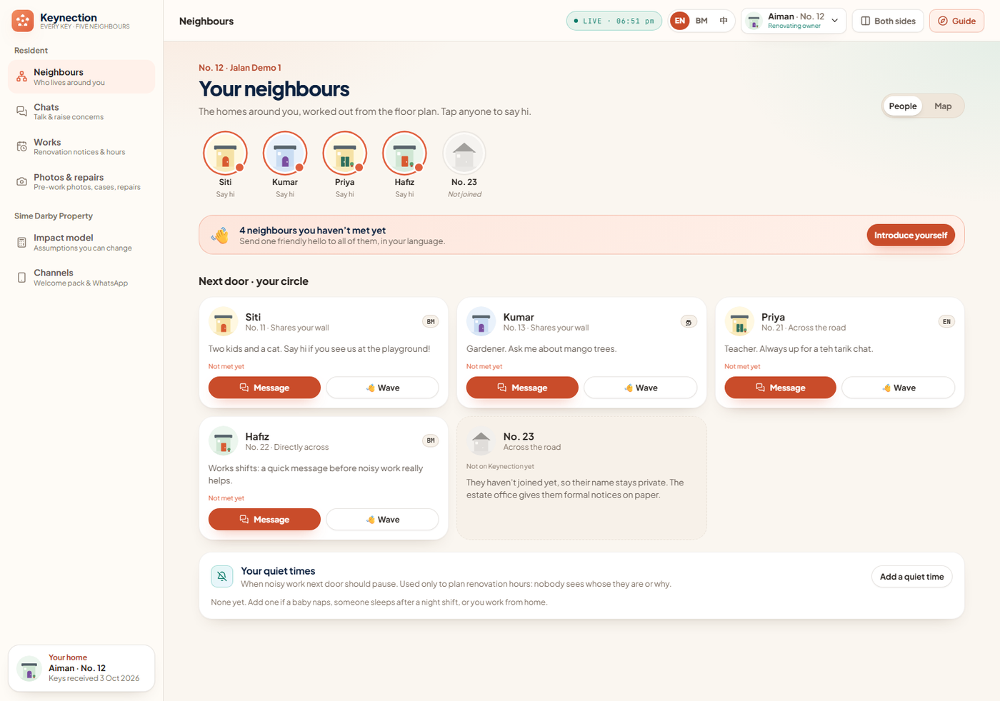
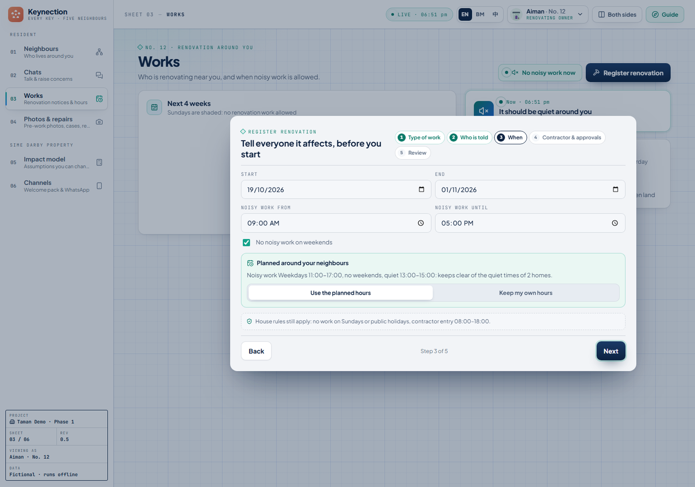
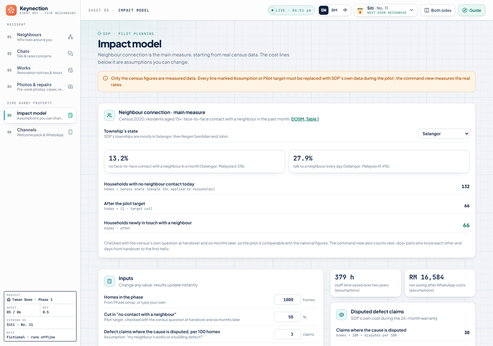

# Keynection

[](https://github.com/DuoCode2/SDP-Hackathon-Township-of-Tomorrow-Keynection/actions/workflows/ci.yml)

> **给队员的中文摘要**：这是给评审（SDP 数码团队）和导师看的英文主页，顺序是：为什么做、3 分钟评审路线、跟现有方案差在哪、为 SDP 而做的地方、主线以外还有什么、哪些是真做哪些是模拟、怎么运行、附录目录、老实说的限制、AI 披露。团队自己的完整中文说明（设计、试点模式、安全清单、结构、待办、Git）一个字没删，搬到了 [`docs/团队说明.md`](docs/团队说明.md)。数字的来源：测试数只在 [`docs/testing-overview.md`](docs/testing-overview.md) 写一次（这一页不写测试数）；普查、纠纷案例、画面数这些以 [`docs/judging-criteria-map.md`](docs/judging-criteria-map.md) 最后一节为准。三张截图在 `docs/images/`，是浏览器自动走路线时拍的、裁掉了右边的导览面板；有 AI 文字的画面等金钥放上去再拍。

Sime Darby Property University Hackathon 2026 · People track. **Every key comes with five neighbours.**

Keynection helps a new owner in an SDP township get to know the five homes beside and opposite them from the day they collect the keys. The renovation season that follows is when neighbours become friends or enemies, so the renovation notice doubles as the first introduction. If a crack or a leak does appear, sealed photos, a fair triage and the warranty clock are there in the background: a safety net, not the hero.



**Live demo**: https://keynection.onrender.com (shared password given privately). It runs on Render's free tier, so the first open after a quiet spell takes about 40 seconds. All judges share one database; it returns to the starting point after 20 quiet minutes. Everything in it is fictional: households, unit numbers, names and photographs are invented or drawn by a program; there is no SDP data and no real resident.

## Why

- **New phases start at zero.** In Selangor, where most SDP townships are, 13.2% of residents had no face-to-face contact with a neighbour in a month (Malaysia 6.5%; Department of Statistics, Census 2020, *Hubungan Sosial*, Table 1). Nobody on a new street knows anyone yet.
- **Renovation is where it goes wrong.** We collected 28 distinct neighbour-renovation incidents reported in Malaysia between 2022 and 2026: illegal extensions and structural changes, party-wall cracks, noise outside hours, debris; some went to the council or the courts. Most are landed homes; the public evidence for apartments is thinner, and we say so. Our reading of them: by the time the two homes talk, it is already a complaint. We also read all 36 public store reviews of SDP's resident apps to see what residents use today.
- **Handover is the one moment SDP meets every owner, and it has no neighbour step.** Neither does the national renovation guideline in force since 1 April 2026, which unifies permits, hours and forms. Keynection adds that step on top of both; it replaces nothing.

Figures and sources, written once: [`docs/judging-criteria-map.md`](docs/judging-criteria-map.md), last section.

## The 3-minute judge route

The route is the top of the **Guide** panel (top-right). One click per step jumps to the screen and the household. Six steps, main story only:

1. **Key day.** Aiman (No. 12) has just moved in; his home screen is the five homes beside and opposite him → 👋 Wave at Siti.
2. **The renovation notice is the introduction.** Works → Register renovation → type one sentence in *Just say it in one sentence* ("Retiling the master bathroom from next Monday for two weeks, weekdays 9 to 6", or tap an example in English, Malay or Chinese, or just say it to the assistant) → *Fill it in for me* → AI picks the type of work and the plan marks who is told (the five, and for wet, hacking or structural works on a terrace the house behind the back fence too) → at *When*, the noisy hours are already planned around the neighbours' private quiet times (Siti's baby nap, Hafiz's night-shift sleep, without saying whose) → review and send. No. 23 is not on Keynection yet, so the estate office prints a paper notice.
3. **Kumar next door (No. 13) reads Tamil.** Channels shows the same notice reaching him on WhatsApp in Tamil, down to the work Aiman described, translated by AI. Below it, two reminders that go out by themselves: photograph three days before the works, a check the day after they end.
4. **Both sides.** One click opens both sides (Aiman left, Siti right), each already in the other's chat. Siti sees the notice: "Noisy hours planned around your quiet time", so she never had to ask about the nap → she waves back → types something sharp in Malay → AI offers her a calmer wording → Aiman reads it in English, the original one tap away.
5. **If something goes wrong.** Siti: Use sample → Sample crack → the crack was there before the works, so it goes to the warranty, not to Aiman.
6. **How SDP checks it works.** The Impact model uses the 2020 census question (share of residents with no face-to-face neighbour contact in a month), asked before and after a pilot. The command view also counts next-door pairs who know each other.

Without an AI key, steps 2 and 4 still work: the three examples fill the notice in from a ready-made preset (the bathroom story is the English one; by hand, keep the first card, *Bathroom, kitchen or plumbing*, and fill in the steps), and typed words go as written. The Guide's top line says whether AI is on. A 7-minute full route is in the Guide under *Show every feature* (see "Beyond the main story" below).

## What is different

Township apps and guardhouse systems already exist in Malaysia: Gamuda's GL Lifestyle+ has one big resident group and renovation forms, i-Neighbour has contractor passes, VYROX runs the guardhouse, and the national renovation guideline covers permits and hours. None of them, as far as we found, has a step where the neighbours actually meet. Keynection's five differences:

1. **The five homes appear on day one, from the site plan.** No directory, no township group, no searching. Beside and opposite for a terrace; beside, above and below for an apartment. The idea borrows from Japan's moving-in greeting to the two homes beside and the three across (向こう三軒両隣).
2. **The renovation notice is the first introduction.** Who is told follows from the type of work (wet work reaches two floors down, hacking two floors up and down) and **the owner cannot remove anyone**. A home not on Keynection yet gets the same notice on paper from the estate office.
3. **Noisy hours are planned before anyone has to ask.** Each household keeps private quiet times (a baby's nap, sleep after a night shift). Plain rules, no AI, set the hours around them and never say whose they are. A home about to get works from both sides is warned, and the second owner is offered a later start.
4. **Typed words arrive in the reader's language**, with a calmer wording offered when a message is heated. Always marked "Translated by AI", the original one tap away, the original kept in every record. Three interface languages (English, Malay, Chinese) and four reading languages (plus Tamil) for everything a resident receives.
5. **A fair photo check, and a ladder instead of a hotline.** A change photographed before the works is never put down to the renovation; "caused by the renovation" needs the other side's agreement; nothing is pre-selected; only the owner closes a warranty ticket. A concern goes to the neighbour first and the estate team last, and every step is written into both home logs.



Nobody is left out: **Easy mode** (bigger text, fewer options, visible only to that household), a **family helper** who can act for an older owner with every action carrying the helper's name, **paper notices** for homes not on the app, and **Tamil** for what residents receive.

## Built for SDP

- **It starts where SDP already is.** The join code goes into the handover welcome pack. The estate office's front desk issues codes, prints paper notices and registers a renovation for an owner who prefers paper.
- **Step one changes nothing in the SDP App.** A one-time code, Keynection in the phone's browser (add to Home Screen), alerts on the WhatsApp everyone already has. Step two, after a pilot, is a module inside the SDP App with the owner's existing sign-in: SDP's own stated direction towards an integrated digital platform (Integrated Annual Report 2025).
- **Counts flow into SDP's own tools.** The command view is named after PACC, SDP's Performance Analytics and Command Centre, and shows counts only, never who talks to whom. Warranty tickets export as a punch list for Procore, SDP's defect system, and the Procore number is written back to the owner's home log.
- **Measured with a question SDP did not invent.** The Impact model starts from the census figure for the township's state and asks the same question at handover and six months later, so a pilot compares directly with the national numbers. Every other line is labelled Assumption or Pilot target, with its formula shown.
- **Pilot mode is built, not promised.** `KEYNECTION_DEMO_MODE=0` turns the same build into a pilot: passkey sign-in with the server deciding identity on every request, CSV import of a real phase, push notifications, PDPA retention and deletion, daily backups, a one-click Render blueprint and a guide for SDP's IT team.



For scale (21 Oct 2026): 18 screens, 106 API endpoints, 3 interface languages plus Tamil, three research reports (4, 10 and 16 Oct), and automated tests plus the front-end build on every push (layers and counts in [`docs/testing-overview.md`](docs/testing-overview.md)).

## Beyond the main story

The demo opens on the six screens of the judge route. The Guide's *Show every feature* switch reveals the rest, one line each here:

- **Home log**: one SHA-256 chain per home (handover, notices, passes, photos, cases, decisions, repairs, owner confirmations); only the app's own steps can write to it; "Chain checked" means the server re-computed the chain and found no silent edit.
- **Me**: reading language, quiet mode, easy mode, blocked list, up to two family helpers, *Download my data* (PDPA: one JSON file, other residents shown as unit numbers only), close the account.
- **Layers 2 and 3**: the same lorong or block shows unit numbers only, contact by request with a reason (three a day, no repeat after a decline); the whole phase has no directory and no group, only the read-only Estate Office account.
- **Hands-free assistant**: say "Hello Neighbour" and the assistant opens and listens, with no tap, and speaks its reply; once the reply has been heard it listens a few seconds more, so the next question needs no wake word, and after silence it waits for "Hello Neighbour" again. The phrase is heard on the device itself (a keyword spotter compiled to WebAssembly, about 8 MB the first time it is switched on); no sound leaves the device before it. Offered once, the first time the chat opens, and off until the household turns it on; paused while the page is out of sight or a voice note is recording.
- **Chats beyond text**: waves, reactions, voice notes up to a minute (deleted after 30 days), a tone check that refuses insults outright (a word list in English, Malay and Chinese, plus the AI's own judgement when it is on), report to SDP's safety team, silent block, phone numbers exchanged only when both agree.
- **SDP command view**: five desks (warranty with the 30-day clock, estate concerns, safety reports, notices to a lorong, a block or the phase, front desk) and counts such as next-door pairs who know each other and days from handover to the first hello.
- **Phase setup**: turn a site plan (lorongs, homes per row, blocks, floors, units per floor) into every circle and notice range with the app's own rules; a thousand homes in about 20 ms, nothing stored.
- **Safeguards**: 14 risks (privacy and PDPA, harassment, false evidence, wrong automated judgement, slow repairs, contractor misuse, AI translation…), each measure marked Built or Pilot and linked to its screen.
- **Under the hood**: photos re-encoded with GPS, camera and time stripped; uploads checked by content, size and pixel count; least-privilege views; security headers; the whole site behind a three-language password page online; fonts, icons and QR generation bundled, so the demo runs with no network.
- **Switched off on purpose**: contractor QR passes and the guardhouse scan, built and tested; they manage workers, not neighbours.

## What is real and what is simulated

The full table, feature by feature, is [`docs/feature-status.md`](docs/feature-status.md). In short:

- **Live** (real logic and real data in the demo): the five homes from the site plan in three layers; wave, hello, one-to-one chat, quick replies pre-translated into English, Malay, Chinese and Tamil; the renovation notice with *who is told* decided by the type of work; noisy hours planned around private quiet times by plain rules; sealed pre-work photos and the follow-up comparison (OpenCV alignment and a darkening rule, **not machine learning**); triage by time order with people deciding; the warranty clock under the Housing Development Act (24 months, 30 days), closed only by the owner; one hash chain per home; the Impact model on real census figures; command-view counts; pilot mode.
- **Live with a key**: one sentence → notice fields (approvals are never filled by AI); typed words delivered in the reader's language with a calmer wording offered when heated.
- **Simulated, and labelled on screen**: the WhatsApp phone and the SDP App phone on the Channels page, the scheduled reminders in the demo, the CIDB registration check, the Procore ticket number in the demo, the guardhouse scan.
- **Switched off in the demo**: contractor QR passes.

## Run it

Python 3.12 or newer and Node.js 20 or newer.

| How | What happens |
|---|---|
| **Windows, one click**: double-click `start-demo.bat` | First run installs everything (a few minutes); after that about 10 seconds. Opens http://localhost:8000 with the back end and the built front end on one port. Keep the window open. |
| **macOS / Linux**: `./start-demo.sh` | Same. |
| **Rehearsal on phones**: add `--lan`, or set `KEYNECTION_LAN=1` | Also opens the demo to phones on the same Wi-Fi and prints the address to type. No password locally, so trusted networks only. |
| **Development**: `start-dev.bat` | Back end with auto-reload on 8000 and the front end with hot reload on http://localhost:5173 . Run `start-demo.bat` once first. |

Manual start (use `.venv/bin/python` on macOS and Linux):

```bash
cd backend
python -m venv .venv
.venv/Scripts/python -m pip install -r requirements.txt
.venv/Scripts/python -m uvicorn app.main:app --port 8000
```

```bash
cd frontend
npm install
npm run dev        # http://localhost:5173
```

Server tests (each test gets its own database; the AI is always a stand-in, so no test reaches Anthropic or Google):

```bash
cd backend
.venv/Scripts/python -m pytest -q
```

Every setting is listed with its purpose in `.env.example` (the server reads environment variables, not that file; a test keeps the two in step). The ones that matter:

| Setting | Effect |
|---|---|
| `ANTHROPIC_API_KEY` | Turns on the two AI features with Claude, the design choice. Without it, with no network, or when the AI does not answer in time, the same screens work by hand. |
| `GEMINI_API_KEY` | The same two features on Google's Gemini free tier, **demo mode only**: the free tier may use inputs to improve Google's products, so pilot mode ignores it. |
| `KEYNECTION_VOICE_KEY` | The assistant's voice on the server, through DuoCode's LLM gateway with its own spending cap: listening for browsers that cannot listen by themselves (Firefox, some phones; Deepgram's Nova-3) and speaking English replies (Deepgram's Aura-2; Malay, Chinese and Tamil replies are read by the browser's own voices). **Demo mode only** until the privacy notice names Deepgram. |
| `KEYNECTION_SITE_PASSWORD` | Puts the whole site behind a three-language password page (the online demo has it set). |
| `KEYNECTION_DEMO_MODE=0` | **Pilot mode**, described under "Built for SDP". Guide for SDP's IT team: [`docs/pilot-deployment.md`](docs/pilot-deployment.md); one-click Render blueprint: `render.yaml`. |

Deployment is one container (`Dockerfile`) serving the back end and the built front end; `/api/health` is the host's check and needs no password.

## Submission appendix

Written for SDP's digital team, in English with a Chinese summary at the top of each page, in this order:

| File | One line |
|---|---|
| [`docs/judging-criteria-map.md`](docs/judging-criteria-map.md) | The six criteria × weights × which screen answers each × which route step × evidence × what is still missing; all figures, written once |
| [`docs/feature-status.md`](docs/feature-status.md) | Every feature: live, live with a key, simulated (and how the screen says so), pilot-only, switched off, not built |
| [`docs/technical-summary.md`](docs/technical-summary.md) | Architecture, four state machines, who may see and do what, where data goes, top ten limitations |
| [`docs/key-decisions.md`](docs/key-decisions.md) | 17 decisions: the choice, the reason, what was given up |
| [`docs/testing-overview.md`](docs/testing-overview.md) | Five test layers and the numbers (written once, here) |
| [`docs/test-plan.md`](docs/test-plan.md) | The manual plan: K00–K15 judge route, K16–K21 boundaries, K22–K23 AI off and shared-demo reset |
| [`docs/glossary.md`](docs/glossary.md) | One name per thing, English and Chinese |

Evidence files (census table, dispute cases, app reviews, real-device check, route screenshots) live in the team folder, not in this repository. The route screenshots, and the three above, are produced by [`e2e/`](e2e/README.md).

## What it is not yet

The honest list judges should hear from us first. The top ten with the pilot fix for each are in [`docs/technical-summary.md`](docs/technical-summary.md), section 5; the full list is in the team notes.

- **Demo mode trusts the unit number in a request**, so judges can switch roles. Only pilot mode signs people in, so the online demo holds fictional data only.
- **The home log is checked by the server that keeps it.** It catches a silent edit to an old entry, not a full recompute or dropping the newest one. Pilot: signed receipts to the owner and a daily outside timestamp.
- **A photo proves upload time, not capture time.** Pilot: in-app camera only, and the renovating owner confirms the pre-work photo.
- **Triage looks at time order only.** Time can rule causes out, not prove them; an inspector decides.
- **Tamil is AI-assisted translation** not yet reviewed by a native speaker. AI translation and the calmer wording can be wrong, especially with mixed Malaysian usage, so they are always labelled and the original is one tap away.
- **Real alerts are not yet proven on a deployed pilot.** WhatsApp needs SDP's own WhatsApp Business account and Meta-approved templates (ready in [`docs/whatsapp-templates.md`](docs/whatsapp-templates.md)); until then the same reminders go as push notifications, verified in a local browser and by tests, not yet on a pilot server.

## Repository layout

```
backend/app/        FastAPI + SQLite. neighbours.py (three layers, who is told), quiet.py (noisy hours),
                    ai.py (Claude / Gemini, stand-in in tests), vision.py (OpenCV), triage.py, ledger.py (hash chain),
                    talk.py (quick replies, tone, notice templates), planner.py, phase_import.py, auth.py (passkeys),
                    push.py, privacy.py, backup.py, seed.py (the fictional phase), main.py (endpoints, security headers)
backend/tests/      pytest, AI always a stand-in
frontend/src/       React + TypeScript. App.tsx, i18n.tsx (EN / BM / 中), guide.ts (both routes), screens/, components/
e2e/                Playwright walks in a real browser: the judge route with a screenshot per step, and more (e2e/README.md)
docs/               the appendix above, the pilot guide, WhatsApp templates, images/, and the team's full notes (Chinese)
.github/workflows/  tests and the front-end build on every push
Dockerfile · render.yaml · railway.json · start-demo.bat / .sh · start-dev.bat · .env.example
```

## AI use and provenance

This code was written with the help of Claude (Anthropic), declared under clause 13 of the competition terms. At run time the prototype uses Claude by design and Google's Gemini free tier on the online demo; both appear in the AI-use disclosure and in the privacy notice residents accept. Only the text being written is sent to an AI service, never the directory, unit numbers or who talks to whom. The one exception is the assistant (one sentence, said or typed, becomes a notice, a hello, a quiet time, a status or a page, ready for the household to check): with the request go the household’s own records (notices, warranty tickets, case status) and its neighbours’ unit numbers, never their names or what they wrote. Speaking to the assistant (the mic button, or after "Hello Neighbour") uses the browser's own speech recognition, which in Chrome and Edge is a Google or Microsoft service; a browser without one sends the recording, through DuoCode's LLM gateway, to Deepgram, in the demo only, and the recording is not kept. A spoken question's reply is read aloud: English by Deepgram through the same gateway (the reply's words only), other languages by the browser's own voices. The wake word itself is heard on the device and sends nothing. This is a fresh codebase for the hackathon; it contains no code from any team member's earlier projects.

## Team notes

The full Chinese write-up (design, pilot mode, security list, every known limitation, structure, to-do, git) is [`docs/团队说明.md`](docs/团队说明.md).
